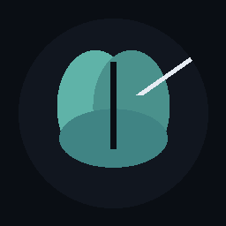
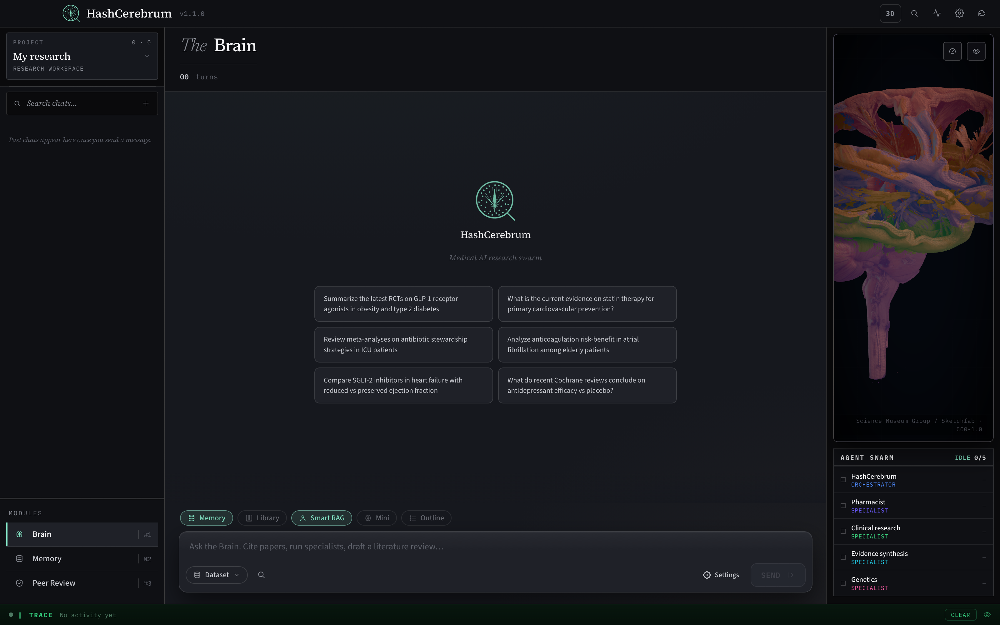
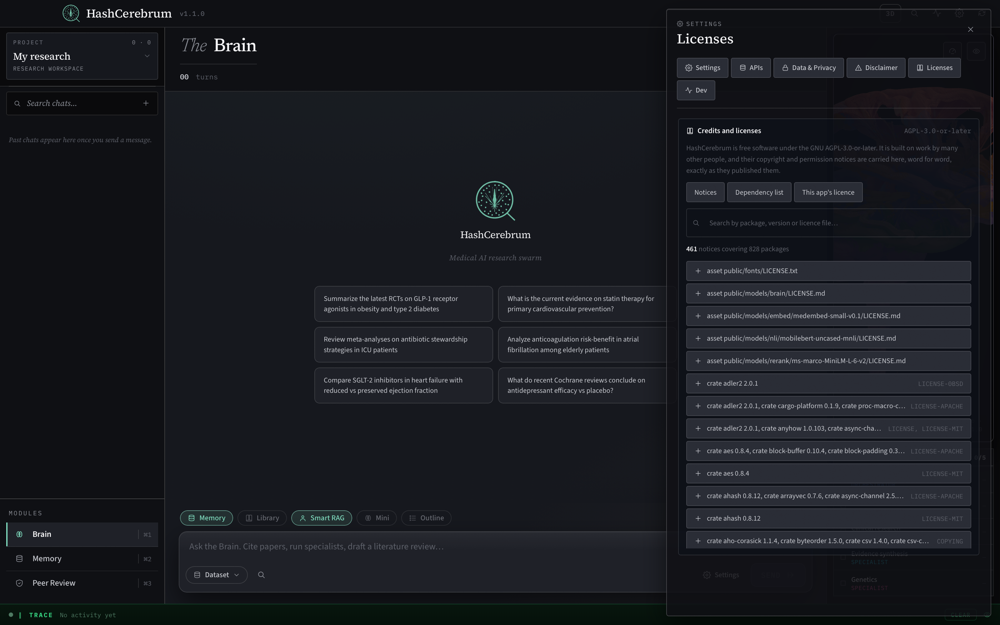

<div align="center">



# HashCerebrum

### Medical research, cited to the paper, on your own machine.

Ask a clinical question. Get an answer where every claim carries a citation<br>
to a real publication — or a full typeset paper. No account, no cloud storage, no telemetry.

**In the making since 19 May 2026.**

<a href="https://github.com/Hash-7777/HashCerebrum/releases/latest"></a>
<a href="https://hashcerebrum.com"></a>
<a href="docs/SECURITY.md"></a>
<a href="docs/ARCHITECTURE.md"></a>

<a href="https://github.com/Hash-7777/HashCerebrum/actions/workflows/ci.yml"></a>


</div>

<br>



<br>

| | |
|---|---|
| **Nothing phones home** | No analytics, no crash reports, no update checks. The web layer cannot open a connection at all; only the Rust core can, and only to a fixed list of addresses in [SECURITY.md](docs/SECURITY.md). |
| **Every claim is traceable** | Answers cite `[S#]` back to a real record. A citation to something that was never retrieved is removed, and a figure that contradicts the source it cites is stripped. |
| **Real sources, not a model's memory** | Searches PubMed, Europe PMC, OpenAlex, ClinicalTrials.gov, openFDA, RxNorm, Semantic Scholar, Crossref, the GWAS Catalog and ClinVar, and reads the papers it finds. |
| **Yours alone, offline if you want** | Point it at a model on your own machine and the app makes no outside call at all — the search, ranking and fact-check models are in the app and run on your computer. |
| **Readable to the last line** | AGPL-3.0-or-later. Strict TypeScript and Rust, 1,219 frontend tests and 84 Rust tests, all run in CI. |

> **This is a research aid, not a medical device.** It does not diagnose, prescribe
> or give clinical advice, and nothing it writes is a substitute for a qualified
> clinician's judgement or for reading the papers yourself. Check every citation
> before you rely on it.

## Three modes

| | |
|---|---|
| **Brain** | The workspace. A lead agent routes your question to specialists — pharmacist, clinical research, evidence synthesis, genetics — which fetch evidence and answer with citations, or draft a full paper. Drug-interaction and gene questions are recognised and handled by their own graded checkers. |
| **Memory** | Everything the app has saved for a project: each finding, where it came from, and the question that produced it. Search it by meaning or by exact words, read it as a list or as a 3D map, and import your own PDFs into it. |
| **Peer Review** | Your draft beside the evidence. Ask the paper questions, get suggestions you accept or reject one at a time, and export the result. |

## How an answer is built

**Retrieve, then rank, then write — and then check what was written.** The question is
planned into searches, the sources are fetched and de-duplicated, passages are
ranked by meaning and by exact words together, and only the passages that
survive are shown to the model. What comes back is checked against those
passages before you see it: a claim whose citation does not support it is cut,
not softened.

- **Evidence first.** Study type, year and journal are read off each record, so a
  randomised trial is not treated the same as a case report.
- **Checked against the source, in code.** An entailment model in the app reads
  each cited sentence against the passage it cites. Nothing about that check is
  left to the writing model.
- **Names are verified, not trusted.** Genes are checked against HGNC and drugs
  against RxNorm, so an invented gene or drug is flagged rather than scored.
- **Grades are computed, never written by a model.** Drug pairs get an A-to-X
  grade, gene-disease links a 0-100 score, both worked out in code from the
  evidence that was actually retrieved.
- **Papers are typeset, not pasted.** A draft becomes a PDF through an embedded
  typesetting engine, with numbered references in the citation style you chose.

## Where the evidence comes from

| Source | What it gives |
|---|---|
| **PubMed · Europe PMC** | The literature, with abstracts and open-access full text |
| **ClinicalTrials.gov** | Registered trials, their status and their results |
| **openFDA · RxNorm** | Drug labels and verified drug names |
| **OpenAlex · Semantic Scholar · Crossref** | Journal metadata, citation counts and links between papers |
| **GWAS Catalog · ClinVar** | Gene-disease associations and variant interpretations |

Each one is on a fixed list in the Rust core; anything not on that list is refused.

## Your models, your choice

Twenty-two cloud providers and Ollama, on your own keys. The lead agent and the
specialists can each run on a different model, and a failing provider hands over
to the next one in the chain rather than stopping the run.

Three small models ship inside the app and run on your computer: one to search
your memory by meaning, one to re-rank what it finds, and one to check an answer
against its sources. They are never downloaded and never contacted.

## Security, stated plainly



- **The interface cannot reach the network.** Every outbound request is made by
  the Rust core, which refuses any address not on its list, follows no
  redirects, resolves names itself so a listed name cannot be pointed at a
  private address, and caps what it will read.
- **Every request is recorded** in a tamper-evident log you can read and verify
  in Settings: each entry seals the one before it, so an edit or a deletion
  breaks the chain.
- **Your keys stay in the app's own folder** on your machine, protected by your
  user account. They are not encrypted at rest; that is stated here rather than
  implied otherwise.
- **Prompts go only where you send them.** Choosing a cloud model sends your
  question and the retrieved evidence to that provider under their terms.
  Choosing a local model sends nothing anywhere.
- **What it is not:** the build is not signed or notarised, and this is not a
  HIPAA or GDPR compliance tool. Do not put patient data into it.

Everything it does, and does not, is in [SECURITY.md](docs/SECURITY.md). Every
third-party licence and notice the build carries is in **Settings → Licenses**,
and in [THIRDPARTY-NOTICES.md](THIRDPARTY-NOTICES.md).

## Install

**macOS (Apple Silicon).** Download the DMG from the [latest release](https://github.com/Hash-7777/HashCerebrum/releases/latest) and drag HashCerebrum to Applications. The build is not notarised: on first launch, right-click the app, choose **Open**, then **Open** again. If macOS still refuses:

```bash
xattr -dr com.apple.quarantine /Applications/HashCerebrum.app
```

**Windows and Linux.** Build from source, below.

Then open **Settings → APIs**, add a provider key, or run a model on your own
machine with Ollama and leave the keys out entirely.

<details>
<summary><b>Build from source</b></summary>

<br>

```bash
cd ~
git clone https://github.com/Hash-7777/HashCerebrum.git
cd HashCerebrum
npm install
npm run dev       # develop
npm run build     # package for this platform
```

Needs Node 18+ and Rust via `rustup`, plus **macOS:** Xcode Command Line Tools · **Linux:** the Tauri v2 system libraries · **Windows:** MSVC build tools and WebView2.

Before a pull request, run what CI runs:

```bash
npm run typecheck && npm test -- --run && npm run build:web
cargo test --manifest-path src-tauri/Cargo.toml
```

Tauri v2 · Rust · React with strict TypeScript.
[Architecture](docs/ARCHITECTURE.md) · [Security](docs/SECURITY.md) · [Licences](docs/LICENSES.md) · [Contributing](CONTRIBUTING.md)

</details>

## FAQ

**Is it free?** Yes. AGPL-3.0-or-later, no paid tier. You pay your model providers directly, or nothing with a local model.

**Does it work offline?** The app and its three built-in models do. Searching the literature needs the internet, and so do cloud models.

**Does my research leave my machine?** Only inside a request to the model you chose, and inside the searches you asked for. There is no HashCerebrum server.

**Are my keys encrypted?** No. They sit in the app's own folder, protected by your user account.

**Can I trust what it writes?** Trust the citations, not the prose: every claim is meant to be checked against the paper it names, and the app is built to make that quick.

| Shortcut | Action |
|---|---|
| `Cmd/Ctrl + 1 · 2 · 3` | Brain · Memory · Peer Review |
| `Cmd/Ctrl + ,` | Settings |

## The Hash ecosystem

| App | What it is | Licence |
|---|---|---|
| **HashCerebrum** *(you are here)* | Medical research workbench with a 3D brain interface | AGPL-3.0 |
| [**HashCortx**](https://github.com/Hash-7777/HashCortX) | The local-first AI workspace | MIT |
| [**HashMeterAi**](https://github.com/Hash-7777/HashMeterAi) | An honest local meter for your AI usage | Apache-2.0 |
| [**HashNotch**](https://github.com/Hash-7777/HashNotch) | Turns the MacBook notch into a live activity island | GPL-3.0 |
| [**Hash LMG**](https://github.com/Hash-7777/open-Hash-LMG) | Describe a film in a sentence and have it designed, scored and rendered on your machine | GPL-3.0 |

They connect through files on your disk, not a service: HashCerebrum records
token counts for **HashMeterAi**, and posts a short "finished" notice, never a
question or an answer, for **HashNotch**.

<br>

<div align="center">

**HashCerebrum** · since 19 May 2026 · by [Seif Hashish](https://github.com/Hash-7777) · [AGPL-3.0-or-later](LICENSE)

[Download](https://github.com/Hash-7777/HashCerebrum/releases/latest) · [Website](https://hashcerebrum.com) · [Security](docs/SECURITY.md) · [Architecture](docs/ARCHITECTURE.md)

</div>
