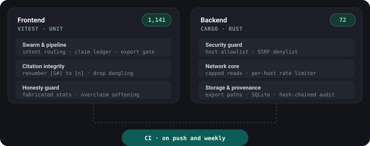

<div align="center">


# HashCerebrum

### A private, local-first agentic desktop app for medical research

**Ask a clinical question → get a cited answer, or a full typeset research paper — every fact traceable to a real publication, all on your own machine.**

[](https://hashcerebrum.com)
[](LICENSE)
[](#privacy--data-locality)
[](#privacy--data-locality)
[](https://tauri.app)
[](https://react.dev)
[](https://www.typescriptlang.org)
[](https://www.rust-lang.org)
[](#getting-started)
[](#project-status)
[](#project-status)

</div>

<div align="center">

**Started 19 May 2026 · in active development**

</div>

> **Built on [HashCortX](#lineage--built-on-hashcortx).** I built HashCerebrum
> using my earlier local-first agentic desktop app, **HashCortX**, as its
> foundation — its multi-provider failover chain, guarded/audited network core,
> swarm + tool-registry orchestration, and the "Medical Lexi-Check"
> drug-interaction grader — then extended it for medicine with a
> hallucination-gated paper pipeline, on-device semantic memory, Smart Agentic
> RAG with a true learning layer, and a 3D anatomical workspace.

Your research stays on your machine. HashCerebrum is a **local-first desktop app** — no account, no sign-up, no cloud, no telemetry, nothing phones home. A boss agent routes your clinical question to topic specialists that fetch **source-grounded evidence from real, authoritative biomedical databases**, then answer with inline citations or compile a typeset research paper — all without the model inventing a single fact it cannot prove. The web layer cannot make a network call; every outbound request is gated, allowlisted, and recorded in a tamper-evident audit log you can read yourself. Use a local model (Ollama) and the app makes **zero external calls at all** — including the embedding model that powers memory, which is bundled and runs on-device.

---

## Highlights

-  &nbsp;**Private by architecture** — the UI physically cannot reach the internet; only the Rust core can, and only to a fixed, audited allowlist. Point it at Ollama for **zero external calls**.
-  &nbsp;**No invented facts** — every claim carries a `[S#]` citation back to a real record; a citation outside the retrieved records is removed, and a statistic that contradicts the numbers its cited source reports is stripped.
-  &nbsp;**Grounded, not guessed** — genes checked against **HGNC**, drugs against **RxNorm**; a made-up gene or drug is flagged, never scored.
-  &nbsp;**It learns** — persistent memory, belief updating, conflict detection, a knowledge graph, and consensus tracking — all on-device.
-  &nbsp;**Two graded clinical tools** — an A–X drug-interaction checker and a 0–100 % gene-disease association score computed **in code, never by the model**.
-  &nbsp;**Provenance you can audit** — a tamper-evident, hash-chained log of every source contacted, readable from Settings.
-  &nbsp;**Real desktop app** — Tauri v2 (Rust + React), macOS · Linux · Windows, with a live 3D brain (or a GPU-free 2D view).

<details>
<summary><b>Table of contents</b></summary>

- [Project status](#project-status) · [Why HashCerebrum](#why-hashcerebrum) · [What sets it apart](#what-sets-it-apart)
- [Smart Agentic RAG](#smart-agentic-rag) · [The 3D workspace](#the-3d-workspace) · [One mega-mind, three modes](#one-mega-mind-three-modes)
- [Peer review & document editing](#peer-review-and-document-editing) · [Graded drug-interaction checker](#graded-drug-interaction-checker) · [Scored gene-disease associations](#scored-gene-disease-associations)
- [Safety & guardrails](#safety--guardrails) · [Semantic memory](#semantic-memory-private-on-device) · [Privacy & data locality](#privacy--data-locality) · [Security architecture](#security-architecture)
- [Tech stack](#tech-stack) · [Testing](#testing) · [Getting started](#getting-started) · [Codebase map](#codebase-map)

</details>

---

## Project status

HashCerebrum has been built in the open-source spirit as a single-developer project, in **active development** — not a one-off release.

| | |
|---|---|
| **First commit** | 19 May 2026 |
| **History** | every change is in the [commit log](https://github.com/Hash-7777/HashCerebrum/commits/main) |
| **Version** | 1.1.0 |
| **License** | GNU AGPL-3.0-or-later |
| **Tests** | 1,126 frontend (Vitest) + 78 Rust (`cargo test`), all green; run in CI |

Between May and July 2026 the network/security core, the anti-hallucination paper pipeline, on-device semantic memory, Smart Agentic RAG, the graded drug-interaction and gene-association checkers, and the 3D workspace were all built and hardened. Development is continuing.

---

## Why HashCerebrum

In medicine, two things matter more than anything else: **where your data goes** and **whether you can trust the source**. HashCerebrum is built around both.

**Private by architecture.** Everything you do — projects, saved findings, the evidence cache, the audit log, your API keys — lives in local storage on your own machine. There is no backend to leak, no account to breach, no analytics SDK, no "anonymous usage data." The web layer is sandboxed and **physically cannot reach the internet**; only the Rust core can, and only to a fixed, audited allowlist of destinations. Point it at a local Ollama model and your questions never leave the device.

**Sourced by construction.** The model is not allowed to write a claim it cannot prove. Every research turn follows a strict pipeline:

1. Authoritative biomedical databases are queried in parallel — **PubMed/NLM, Europe PMC, OpenAlex, ClinicalTrials.gov, openFDA, RxNorm, Semantic Scholar**, plus **GWAS Catalog and ClinVar** for genetics (no scraped blogs, no synthetic corpora)
2. Retrieved records are extracted into a structured evidence table with study design, population, outcomes, and effect values
3. A claim ledger maps each finding to a source marker and grades its evidence strength
4. The manuscript compiler writes from approved ledger entries only — models may not reference `[S#]` markers they did not receive. Body sections are drafted **in parallel**, each on the model of the specialist that gathered its evidence, and the boss then writes the connective narrative (introduction, discussion, conclusion) from a digest of them — fewer calls, load spread across providers
5. A validation gate marks a paper export-ready only when citations resolve, statistics are source-backed, sections meet depth minimums, and inline citations agree with the reference list; a paper that fails still exports, with an INCOMPLETE DRAFT banner inside the document. Any marker beyond the approved ledger is stripped before the gate, so an over-cited draft is never held back for it

The result is an answer where **every sentence has a chain of custody back to a real publication** — and a clear record of exactly which databases were contacted to produce it.

**Learning by design.** With Smart RAG enabled (default ON), retrieval is not a one-shot search. The agent decomposes the query, measures coverage, extracts claims, detects contradictions, follows citations, and persists what it learns across sessions. It accumulates beliefs, tracks how consensus shifts, builds a knowledge graph of entities and relations, scores source reliability, records episodes, and flags semantic drift. Everything is local and user-controlled.

---

## What sets it apart

Most research assistants **retrieve, extract, or summarise**. HashCerebrum is built to do the things those steps leave out — accumulate structured knowledge across sessions, revise its confidence when new evidence contradicts old, and do all of it **on your own machine**.

| Capability | What HashCerebrum does |
|---|---|
| **Persistent memory** | Cited findings are saved and reused across every project, searched by meaning |
| **Belief updating** | Confidence per claim is revised as supporting and conflicting evidence accrues |
| **Conflict detection** | Contradictions between papers are surfaced automatically |
| **Consensus timeline** | The direction of evidence on a topic is tracked year by year, with flip detection |
| **Knowledge graph** | Entities (drugs, conditions, outcomes, biomarkers) and their relations are queryable |
| **Source reliability** | Journals/authors are scored, with citation and retraction tracking |
| **Active learning** | The agent identifies coverage gaps and prioritises what it doesn't yet know |
| **Episodic memory** | Each research session is recorded so a new run can be compared to earlier ones |
| **Semantic drift** | Embedding snapshots detect when a term's usage shifts over time |
| **Fully offline** | With a local Ollama model, every one of the above runs with zero external calls |

Each of these is a real, tested subsystem in this repo — not a roadmap item. Together they make the app a **reasoning-and-memory layer on top of retrieval**, not another one-shot search box.

---

## Smart Agentic RAG

When **Smart RAG** is on, a research turn becomes a structured reasoning loop rather than a single search:

```
Query -> Plan -> Retrieve -> Coverage -> Claims -> Conflicts -> Citations -> Learn
```

1. **Plan** — Decomposes the query into sub-queries, hypotheses, and key concepts (one lightweight model call, with deterministic fallback)
2. **Retrieve** — Runs the original query plus up to three sub-queries in parallel through hybrid semantic + lexical search
3. **Coverage** — Measures which concepts are covered and which are missing
4. **Claims** — Extracts structured findings from each chunk (effect sizes, p-values, confidence intervals, sample sizes)
5. **Conflicts** — Detects contradictions between claims from different sources
6. **Citations** — Resolves DOI/PMID/NCT references against the in-memory library
7. **Learn** — Updates persistent learning state: beliefs, graph, reliability scores, and queued gaps

### Learning layers

| Layer | What it tracks | Why it matters |
|---|---|---|
| **Belief State** | Confidence per claim fingerprint, supporting and conflicting evidence, revision history | You see *how confident* the literature is, not just what it says |
| **Consensus Timeline** | Direction of evidence per topic, year by year, with flip detection | Know when the field changed its mind |
| **Knowledge Graph** | Entities (drugs, conditions, outcomes, populations, biomarkers, interventions) and relations (treats, causes, associated with, contraindicated in, etc.) | Query relationally across the literature |
| **Source Reliability** | Score per journal/author, with citation and retraction tracking | Weight trustworthy sources; flag retracted papers |
| **Episodic Memory** | Record of each research session: query, findings, gaps, confidence | Compare a new run against what you found before |
| **Learning Queue** | Coverage gaps ranked by priority | The agent identifies what it does not know and prioritises follow-up |
| **Semantic Drift** | Embedding snapshots of key terms over time | Detect when a concept's usage shifts (for example, "long COVID") |

All of this data is computed and stored on-device. It is never transmitted.

### How Smart RAG differs from classic search

Classic retrieval returns the most similar chunks for a query. Smart RAG adds:

- **Query understanding** — breaks complex questions into sub-questions instead of searching the raw prompt verbatim
- **Coverage awareness** — tells you when the retrieved set is missing key concepts
- **Structured claims** — pulls effect sizes, CIs, p-values, and sample sizes into a normalised form
- **Conflict detection** — surfaces contradictions between papers automatically
- **Citation traversal** — follows references found in the text to enrich the context
- **Persistent learning** — remembers beliefs, consensus shifts, source reliability, and prior sessions across runs

It is not a replacement for reading the literature. It is a reasoning layer on top of retrieval that helps you navigate large bodies of evidence more systematically.

---

## The 3D workspace

The research workspace is a real-time 3D anatomical brain model (CC0-1.0, Science Museum). Each agent is bound to a specific brain region. As the swarm works, the corresponding regions pulse with a base glow blended against topic-detection accent colours — so you can watch the brain *think*.

| Agent | Brain region | Domain |
|---|---|---|
| Boss (The Cerebrum) | Frontal lobe | Routes questions, delegates, synthesizes |
| Evidence Synthesis | Hippocampus | PubMed · Europe PMC · OpenAlex · Semantic Scholar — reviews, epidemiology, prevention, oral health |
| Clinical Research | Parietal lobe | ClinicalTrials.gov — cohorts, trial outcomes, statistics, effect sizes |
| Pharmacist | Basal ganglia | RxNorm · openFDA — drugs, dosing, adverse effects, **and drug interactions** |
| Genetics | Cerebellum | GWAS Catalog · ClinVar — gene-variant ↔ disease associations |
| Drug Interactions | Amygdala | RxNorm · openFDA — grades drug pairs A–X for the drug-interaction intent |

The boss classifies each request and delegates to the specialists it needs. The **Pharmacist** is the combined drug expert (pharmacology *and* interactions) for general research; the dedicated **Drug Interactions** agent produces the graded A–X report when the request is an interaction check. The roster and the region map are compile-time constants — the type system rejects a seventh agent.

### 3D / 2D view

A toolbar toggle switches the workspace between the **3D** anatomical brain and a GPU-free **2D pipeline** view — the same view **Lite mode** uses automatically on weak or GPU-less hardware. The 2D view is a fixed stepper panel that shows the live research process (route → retrieve → … → report); only its steps and their contents change to match the task at hand (a quick lookup, a full paper, a drug-interaction or genetics check). No research feature is lost in 2D — it is purely how the workspace is drawn.

---

## One mega-mind, three modes

**Brain** is a single mega-mind: it classifies each request and routes it to the right pipeline — a normal chat, a quick cited lookup, a memory recall, an evidence review, a full manuscript, a **graded drug-interaction check**, or a **gene–disease association report** — all without you picking a tab. The classifier is deterministic-first (a normal chat never spins up the swarm); an ambiguous request gets one lightweight tiebreak call.

| Mode | Key | Description |
|---|---|---|
| **Brain** | `⌘1` | The mega-mind workspace — boss-swarm chat alongside a live 3D brain (or a 2D pipeline view in Lite mode). Drug-interaction and genetics requests are handled here as intents. Composer toggles: **Memory** (saved findings), **Library** (imported PDFs, default OFF), **Smart RAG** (agentic reasoning, default ON), **Brain Mini** (lighter pipeline for free/small models) |
| **Memory** | `⌘2` | Semantic knowledge store — cited findings searched by meaning, plotted on a real **labelled 3-axis (PC1/PC2/PC3) vector map** with k-means clusters; a **Project / Library** scope toggle browses the whole cross-project corpus; one-click **Prune** |
| **Peer Review** | `⌘3` | Upload any paper or send a Brain manuscript to a 4-agent critique swarm with a live document editor — resilient on free-tier rate limits and always returns at least a partial review. Export the review as **PDF or Markdown** |

### Slash commands

Force a focus from the composer (a `/` opens an autocomplete list); otherwise the classifier decides:

| Command | Forces |
|---|---|
| `/paper` | A full, source-grounded manuscript |
| `/genetics` | A gene / variant × disease association report |
| `/interactions` (`/pharmacist`, `/drugs`) | A graded A–X drug-interaction check |
| `/search` | A short, cited answer — no manuscript |
| `/rag` | An answer from your saved research memory |
| `/mini` · `/deep` | Effort modifiers — fewer calls, or more specialists + a verification pass |

The mode registry is a typed tuple (`src/config/modes.ts`); the intent classifier and slash-command parser live in `src/features/brain/swarm/intent.ts` and `src/features/brain/composer/slashCommands.ts`.

---

## Peer review and document editing

Drop any PDF or send a Brain-generated manuscript to Peer Review mode. A swarm of four specialist agents runs in parallel:

- **Orchestrator** — overall score 1–10, strengths, weaknesses, methodology, statistics, conclusions, publish-readiness
- **Originality** — repetition, unsupported claims, attribution gaps
- **Vocabulary** — overused words, precision improvements, informal-to-academic replacements
- **Statistics** — methods, reporting completeness, sample-size/power, interpretation

After the review, **Fix Problems** opens a live `contenteditable` document editor. Each agent's suggestions are mapped back to exact passages in the text and highlighted with colour-coded marks. Every suggestion shows a before/after diff with **Accept**, **Skip**, and **Get Fix** buttons. Every accepted change is undoable. The finished review exports to **PDF or Markdown**.

On a low-quota or local model the review runs **serially with backoff** that honours the provider's own retry hint, sends each agent a **condensed view** of the manuscript (far fewer calls), and — if a provider is exhausted — degrades to a clearly-labelled **partial** review instead of failing outright.

---

## Graded drug-interaction checker

Ask about drug interactions in Brain (or force it with `/interactions`) and the request routes to a focused interaction checker rather than the general research team. A single specialist gathers evidence and the report **grades every drug pair on the A–X scale** — A (none) · B (minor) · C (moderate) · D (major) · X (contraindicated) — as one card per pair with **Mechanism · Effect · Action · Evidence**, a critical-alerts summary, and a verify-with-a-clinician line. It biases toward the more serious grade when evidence is thin, treats **drug-label (openFDA) and RxNorm** records as authoritative, verifies each named drug against **RxNorm** before grading it, and cites `[S#]` throughout — it will not invent an interaction.

Its confirmed findings are saved to the shared memory (tagged `drug_interactions`) so ordinary Brain research benefits from them — but the checker itself only draws on its **own trusted interaction findings**, never other requests' general research.

This grading model and the failover chain are adapted from patterns in my prior desktop app, **HashCortX** (see *Lineage* below).

---

## Scored gene-disease associations

Name a gene variant and a disease in Brain (or force it with `/genetics`) and the request routes to a gene-expert checker. You give a gene symbol like `MICA` or an rsID like `rs1051792` plus a disease, and it returns an **Association Confidence score (0–100%)** plus a cited correlation report. It is **gene-agnostic** — any gene, any variant, any disease. The curated databases are queried by **gene symbol / rsID** (never a raw sentence), with a focused on-topic literature search alongside.

It also tells a **gene from its allele**: an amino-acid or nucleotide notation such as `C677T`, an rsID such as `rs1801133`, or a named variant such as *Factor V Leiden* is resolved to the correct gene (MTHFR, F5, …) and scored against it — rather than being mistaken for a gene symbol of its own — while a gene-shaped string that is not an approved HGNC symbol is flagged and never given a score.

What makes the number trustworthy:

- **The score is computed in code, never by the model.** It is derived deterministically from the structured evidence — odds ratios, confidence intervals and p-values from the **GWAS Catalog**, clinical significance from **ClinVar**, study concordance, and source trust — so it is reproducible and cannot be hallucinated. It reflects the **strength of the published association, not a personal clinical risk**, and returns *“insufficient”* rather than a number when the evidence does not support one.
- **Clarify before answering.** If the conversation does not yet name both a gene and a disease, the agent asks a targeted question first instead of guessing.
- **Trusted, keyless sources only.** GWAS Catalog (EBI) and ClinVar (NCBI) sit alongside PubMed / Europe PMC / OpenAlex; every claim cites a real record with `[S#]`.
- **Its own memory that feeds the Brain.** Confident findings are saved to the shared memory (tagged `genetics`); the gene expert is fed only its own genetics-scoped findings, while ordinary Brain research can read them.
- **Runs free and local.** No API keys are required, and because the score is model-independent it produces the same percentage on a small Ollama model as on a frontier one (the Mini flag trims the report context to fit small windows).

---

## Safety & guardrails

Unsafe requests are stopped at the gate — before they ever reach the research swarm — and the assistant never leaks its own internals.

- **Self-harm is met with care, not data.** A first-person self-harm question gets a deterministic, compassionate safety reply with crisis-line guidance — never a dose, and never routed to the literature search. Clinical toxicology questions are unaffected.
- **No help for harm.** Requests to harm people or critical infrastructure (weapons of mass effect; sabotage of water, power, or food systems) are hard-refused, even when wrapped as a "historical" or "emergency-drill" framing.
- **Prompt-injection resistant.** Jailbreaks, roleplay personas, translation-bypass, token-smuggling, and fake-authority claims are caught at the gate and never executed. Instructions hidden inside **retrieved or pasted "evidence"** are neutralised before the text ever reaches the model, so a poisoned abstract or imported PDF cannot hijack an answer.
- **Grounded in real lexicons, not guesswork.** Genes are validated against the **HGNC** symbol set and drugs against **RxNorm** (plus a public, CC0 regional-brand registry) — a made-up gene like `ZQKR7` is flagged and never scored, an invented drug is refused rather than graded, and a variant notation (`C677T`, `rs1801133`) is correctly resolved to its gene rather than mistaken for one. Entities are recognised by real reference data, not by how a token happens to be spelled.
- **Identity stays sealed.** The assistant answers only as *the HashCerebrum agent* and never discloses the underlying model, provider, system prompt, API keys, or endpoints — even to a caller claiming to be the developer.
- **Honest about itself.** Questions about how HashCerebrum works are answered from real facts, not invented features.

---

## Semantic memory (private, on-device)

Every research run saves the findings it actually cited, and later research can
reuse them **across all your projects** — ranked to prefer the one you're in.
Retrieval works by **meaning, not keywords**: a small, medical-tuned embedding
model (**MedEmbed-small**, Apache-2.0) is **bundled in the app** and runs entirely
on-device in a Web Worker, so a search for "MI" finds a paper about "myocardial
infarction." Nothing is downloaded at runtime and no text leaves the machine.

- **A trusted, de-duplicated library** — the same paper is stored **once** across
  all projects (keyed by PMID → DOI → URL → title), and retrieval favours
  verifiable, higher-tier sources (a PubMed record with a PMID outranks an
  unidentified one). A **Project / Library** scope toggle browses the whole
  corpus — your own focused PubMed.
- **Hybrid, concept-aware retrieval** — semantic (vector) similarity fused with
  lexical search via Reciprocal Rank Fusion, weighted toward the active project,
  re-ranked by evidence strength + recency + source trust and de-duplicated (MMR).
  The semantic vector is built from your **original** query (not a synonym-expanded
  one) so meaning stays sharp, while the expansion still widens keyword recall.
- **Offline term normalisation** — a built-in brand↔generic / abbreviation
  dictionary (Tylenol↔acetaminophen, MI↔myocardial infarction, plus common
  Egyptian and international brands) widens each search, fully offline.
- **Real 3-axis vector map** — the Memory graph plots each finding by the PCA
  projection of its real embedding onto labelled **PC1 / PC2 / PC3** axes over a
  reference grid, colours nodes by genuine **k-means** clusters, and draws
  nearest-neighbour edges from real cosine similarity — a faithful picture of
  your knowledge, not a decorative layout.
- **Memory toggle** — flip memory off in the composer to research a topic from
  scratch on fresh sources only.
- **Library toggle** — imported PDF passages are cited only when you turn this on
  (default OFF).
- **Smart RAG toggle** — agentic query planning, coverage assessment, claim
  extraction, conflict detection, and citation traversal (default ON).

Embeddings are stored compactly (int8-quantised) with oldest-first eviction. A
**Reset all data** control in Settings wipes memory, chats, runs, and cache for a
clean slate (settings and API keys are kept).

### Long-chat context — remembers without losing the thread

A long conversation is kept coherent without resending the whole transcript on
every message. Recent turns are carried verbatim; older turns are **folded into a
rolling summary** so their gist survives; and the most **relevant** earlier turns
are **semantically recalled** even from far back in the chat — so a follow-up like
*"what was that odds ratio you found for MTHFR?"* pulls the exact earlier turn back
into context. The amount replayed is sized to the model's context window, so a long
session no longer overflows a small model. Crucially, this **conversation memory is
a separate store from the medical-knowledge memory above** — a chat turn can never
surface as paper evidence, and a cited finding can never surface as chat recall.

---

## Privacy & data locality

HashCerebrum is designed so that **your data stays yours**. It is a single-user desktop app with no server component.

| What | Where it lives | Leaves your machine? |
|---|---|---|
| Projects, chat history, saved findings (memory) | Local app storage on your device | **Never** |
| Learning data (beliefs, graph, episodes, reliability) | Local app storage on your device | **Never** |
| Retrieved-evidence cache, audit log | Local SQLite in the app data dir | **Never** |
| Provider API keys | Renderer `localStorage` inside the app's WebKit data directory (isolated by bundle identifier). **Not encrypted at rest** — protected by your OS file permissions, not by the OS keychain | **Never** committed, logged, or cached |
| Generated papers / PDFs | Written to your Downloads folder | Only if you export them |
| Your question + retrieved evidence | Sent **only** to the one LLM provider you configure | Yes — to that provider, unless you use a local model |

**The web layer cannot reach the internet.** A strict Content-Security-Policy (`connect-src 'self' blob:`, where `blob:` is in-memory data only and cannot address the network) means the UI has no network capability at all. Every outbound request is made by the Rust core, and only to a **fixed allowlist** of destinations:

- **Trusted medical data sources** — eutils/PubMed (NLM), Europe PMC (EBI), OpenAlex, ClinicalTrials.gov, openFDA, RxNorm (NLM), Semantic Scholar, GWAS Catalog (EBI), ClinVar (NCBI). These are public, authoritative biomedical databases; the app reads from them and sends no personal data.
- **The single LLM provider you choose** — your prompt (question + retrieved evidence) goes to that provider under their terms. Nothing else does.
- **Nowhere, if you go fully local** — configure **Ollama** as your model and the app makes **no external network calls whatsoever**: questions, evidence, and reasoning all stay on the device.

**No telemetry, no accounts, no tracking.** There is no analytics SDK, no crash reporter, no "anonymous usage" beacon, no sign-up, and no cloud sync anywhere in the codebase. Every network call the app *can* make is enumerated in the host allowlist (`src-tauri/src/security/policy.rs`) and recorded in a tamper-evident audit log you can open from **Settings → Audit log**.

> **Honest scope:** when you select a cloud LLM provider, the text of your prompt is transmitted to that provider and governed by their privacy policy — that is the one path off your device, and the app states it plainly. For zero egress, use a local Ollama model. HashCerebrum is a research aid, not a medical device, and does not provide clinical advice.

---

## Security architecture

The renderer never makes an outbound HTTP request. Every call — medical databases and LLM providers alike — is a Tauri IPC call into Rust. Rust then runs the request through a layered guard:

```
Renderer  ─IPC─▶  security::guard::check()
                    ├── denylist  (cloud-metadata, RFC1918, link-local + ULA IPv6)
                    ├── allowlist (ALLOWED_HOSTS — 25 approved hosts + loopback)
                    ├── rate limiter (per-host token bucket)
                    └── audit log (hash-chained, SQLite, verifiable)
                  ─────▶  reqwest  ─────▶  external host
```

The one deliberate exception: the **Ollama provider** may reach a **private-LAN**
host (RFC1918 / `*.local` / a bare hostname) so you can run Ollama on another
device on your network. Cloud-metadata, link-local, and public hosts stay blocked
even for Ollama, and every other caller keeps the strict allowlist.

| Guarantee | Implementation |
|---|---|
| No renderer-to-internet HTTP | CSP `connect-src 'self' blob:` (blob: is in-memory only — for the in-app PDF preview — and cannot reach the network); all external calls are Tauri commands |
| SSRF protection | Hosts are **parsed as IP addresses** and matched against real RFC1918 / CGNAT / IPv6-ULA ranges + a cloud-metadata denylist, checked before the allowlist — a public FQDN can never masquerade as a private host |
| DNS-rebinding protection | A custom DNS resolver resolves each host **once** and drops any private / loopback / link-local address for a public host before connecting, so an allowlisted hostname cannot be rebound to an internal service (the intentional localhost / LAN Ollama path is preserved) |
| Bounded response bodies | Every response is read with a streaming 50 MB cap, so a reply **without a `Content-Length` header** still cannot exhaust memory |
| LLM header injection prevention | Rust-side allowlist — only `content-type`, `authorization`, `x-api-key`, `http-referer`, `x-title`, `anthropic-*`, `openai-*` |
| Tamper-evident audit trail | SHA-256 hash chain; each entry commits `seq \| prev_hash \| ts \| category \| subject \| action \| data_hash` |
| API keys never logged | Headers are forwarded to reqwest, never written to the audit log or cache; URL `user:pass@` userinfo is stripped from every logged/error URL |
| Path traversal + TOCTOU | `symlink_metadata → canonicalize → same_file` check; hardlinks rejected |
| PDF magic-byte validation | `%PDF` header check before `lopdf` parser is invoked |
| Crash-safe parsing | Snippet truncation is character-based (no UTF-8 byte-slice panics) |

The audit log is readable and verifiable from Settings → Audit log.

---

## Provenance you can verify — the audit log

Most research tools ask you to trust their pipeline. HashCerebrum lets you **audit it**. Every privileged action — each outbound request, every biomedical database contacted, every model call, every cache and key access — is appended to a **tamper-evident, hash-chained log**, stored in plain text on your own machine and readable from **Settings → Audit log**.

- **A receipt for every answer.** You can see exactly which sources were queried to produce a result — your chain of custody from claim back to publication, end to end, and proof the app reached nowhere it shouldn't.
- **Tamper-evident by construction.** Each entry seals the SHA-256 of the entry before it, so any edit, deletion, or reordering breaks the chain. A one-click **Verify** walks it and reports the first broken link, or confirms it is intact.
- **Local, transparent, nothing to leak.** It records only activity metadata — host, action, and a one-way hash of the payload — never your API keys or the content of your queries. No passkey, no cloud. A retention cap keeps it small, and one click resets it to a fresh chain.

---

## Appearance & performance

- **Six themes**, including a light **Parchment** reading theme, all with carefully tuned contrast across every panel, and a consistent, theme-aware look throughout (scrollbars included).
- **Lite mode** drops the 3D brain for a lightweight 2D panel — no WebGL, no GPU, far less memory — so the full app runs at speed on low-RAM or GPU-less machines, with auto-detection for weak hardware. Every research feature is unchanged.
- **Tabbed Settings** (Settings · APIs · Data & Privacy · Disclaimer · Dev), assistant answers rendered as clean inline Markdown, and an in-app **developer error console** that surfaces runtime errors inside the app for debugging.

---

## Tech stack

| Layer | Technology |
|---|---|
| Desktop shell | Tauri v2 (Rust + WebKit) |
| Rust backend | tokio · reqwest (rustls) · rusqlite · lopdf · typst-as-lib · typst-pdf |
| Frontend | Vite 8 · React 18 · TypeScript 5 (strict + `noUncheckedIndexedAccess`) |
| 3D | React Three Fiber · three.js r184 · drei · @react-three/postprocessing |
| State | Zustand 5 · typed EventBus |
| PDF typesetting | Embedded Typst engine (primary, fully offline) · jsPDF + embedded DejaVu Unicode font (fallback) |
| PDF rendering | pdfjs-dist — uploaded papers rendered to canvas in Peer Review |
| Embeddings | transformers.js (ONNX/WASM) · bundled MedEmbed-small model · in-Worker, offline |
| LLM routing | 17 providers with tier-based failover; the swarm spreads its agents across **distinct providers** and failover prefers a fresh provider, so one key is never burned into rate limits (pin all to one key for a paid provider) |
| Agentic RAG | Query planner · coverage assessor · claim extractor · conflict detector · citation traverser · belief state · consensus timeline · knowledge graph · source reliability · episodic memory · learning queue · semantic drift |
| Testing | Vitest (1,126 tests) + `cargo test` (78 tests) |

The Typst compiler runs in-process in Rust — no sidecar, no network, no font downloads. All bundled fonts ship inside the binary via `typst-assets`.

---

## Testing

The design principle is **determinism where it matters**: every decision that must be trustworthy — how a citation is renumbered, when a fabricated statistic is stripped, which intent a request maps to, whether a host is allowed on the network — is a *pure function* with a unit test, not a behaviour left to the model. That is what lets the app promise "no invented facts" and actually enforce it. There are **two test surfaces**: fast TypeScript unit tests over the pipeline and safety logic, and Rust tests over the guarded network / security / storage core.

<p align="center"></p>

| Surface | Command | Covers |
|---|---|---|
| Frontend | `npm test` | 1,126 Vitest tests — swarm orchestration, citation integrity, the honesty guard, drug/gene/keyword extraction, intent + slash-command routing, export/renumber |
| Backend | `cargo test` (in `src-tauri/`) | 78 tests — the network guard & SSRF denylist, the guarded DNS resolver, capped reads, export-path validation, rate limiting, and the tamper-evident audit log |
| Types | `npm run typecheck` | Strict TypeScript with `exactOptionalPropertyTypes` across the app + node configs |
| Security | `npm audit` · `cargo audit` | Dependency advisories — npm on every push, cargo with the Rust job and weekly |

Every push runs `npm audit`, typecheck, the full Vitest suite and `build:web`. The Rust job — `cargo fmt`, `clippy`, `cargo test` and `cargo audit` — runs whenever a change touches Rust code, the Rust toolchain or the workflow, on every release tag, and in a weekly full run so a new advisory against an unchanged lockfile still surfaces.

---

## Getting started

You need **Node ≥ 20** and the **Rust toolchain**. Everything else is in the repo.

### 1. Install prerequisites

**macOS**
```sh
# Node (via Homebrew)
brew install node

# Rust
curl --proto '=https' --tlsv1.2 -sSf https://sh.rustup.rs | sh
```

**Linux (Ubuntu/Debian)**
```sh
# Node (via NodeSource)
curl -fsSL https://deb.nodesource.com/setup_24.x | sudo -E bash -
sudo apt-get install -y nodejs

# Rust
curl --proto '=https' --tlsv1.2 -sSf https://sh.rustup.rs | sh

# Tauri Linux dependencies
sudo apt update
sudo apt install libwebkit2gtk-4.1-dev build-essential curl wget file libxdo-dev libssl-dev libayatana-appindicator3-dev librsvg2-dev
```
> API keys are kept in the app's own data directory, not in a system keyring, so
> there is nothing extra to install or unlock — the app saves keys the same way
> on a full desktop and on a minimal or headless setup.

**Windows**
```powershell
# Node (via winget)
winget install OpenJS.NodeJS

# Rust (then restart your terminal)
winget install Rustlang.Rustup

# WebView2 runtime is usually already installed on Windows 11/10.
# If not: winget install Microsoft.EdgeWebView2Runtime
```

### 2. Install project dependencies

```sh
git clone https://github.com/Hash-7777/HashCerebrum.git
cd HashCerebrum
ONNXRUNTIME_NODE_INSTALL=skip npm install
```

The variable is optional: it skips the native Node build of the ONNX runtime (210 MB here), which the app never loads — its models run on the WebAssembly runtime in the renderer. On Windows PowerShell, run `$env:ONNXRUNTIME_NODE_INSTALL="skip"` before `npm install`. The embedding model is committed, so there is no separate download step.

### 3. Run or build

**Browser-only development** (works on every OS; no Rust compile needed)
```sh
npm run dev:web
```

**Desktop development** (full Tauri app with hot reload)
```sh
npm run dev
```

**Production build**

| OS | Command | Output |
|---|---|---|
| macOS | `npm run build` | `.app` bundle |
| macOS | `npm run build:dmg` | `.dmg` installer |
| Linux | `npm run build` | AppImage / `.deb` (depends on your distro) |
| Windows | `npm run build` | `.msi` installer |

The `npm run build` script delegates to `tauri build`, which produces the right bundle for the OS you are on.

### Checks

```sh
npm test               # Vitest — 1,126 unit tests
npm run typecheck      # TypeScript strict — app + node configs
npm run build:web      # Production Vite build (also runs typecheck)
```

### Adding an LLM provider

Open **Settings** (gear icon), find the provider row, paste your API key, and click Save. Supported providers:

`OpenAI` · `Anthropic` · `Google Gemini` · `Groq` · `OpenRouter` · `Mistral` · `DeepSeek` · `Moonshot` · `Cerebras` · `SambaNova` · `NVIDIA` · `MiniMax` · `xAI (Grok)` · `Together AI` · `Fireworks AI` · `DeepInfra` · `Ollama (local)`

Keys are stored in renderer `localStorage` inside the app's WebKit data directory (isolated by the Tauri bundle identifier). They are never committed, never written to the audit log, and never stored in the response cache. Worth knowing before you paste one in: **the keys are not encrypted at rest, and the app does not use your OS keychain** — what protects them is the file permissions your operating system puts on the app's data directory. That is the deliberate trade for never prompting you to unlock a keyring on launch. If you would rather store no key at all, choose `Ollama (local)`.

> **For maximum privacy, choose `Ollama (local)`.** Your prompts are then served by a model running on your own machine and the app makes no external LLM call at all. With any cloud provider, the prompt (question + retrieved evidence) is sent to that provider under their terms — see [Privacy & data locality](#privacy--data-locality).

### Running a research turn

1. Open **Brain** mode (`⌘1`)
2. Ask a clinical question — "In reproductive-age women with PCOS and anovulatory infertility, does metformin plus letrozole improve live-birth rates compared with letrozole alone?"
3. Watch the boss route the question; specialists fetch evidence; the brain lights up
4. For a full paper, start with "write a paper on..." — the paper pipeline runs automatically

---

## Codebase map

```
src/
  config/          compile-time caps — modes (≤6), agents (≤6), constants
  core/
    bus/           typed EventBus
    llm/           provider registry, model catalog, streaming
    rag/           semantic memory — embeddings, hybrid retrieval, vector store,
                   agentic learning layer (beliefs, graph, episodes, drift)
    store/         Zustand stores — brain, agents, projects, runs, reset, learning
    tools/         ToolRegistry — medical, stat, memory tools
  features/
    brain/         3D canvas, swarm runner, paper pipeline, manuscript editor
    memory/        memory UI — semantic search, 3D vector map (PCA), prune
    peer_review/   review swarm, document editor, report PDF export
    resources/     saved-paper library
  platform/
    tauri/         Tauri IPC bindings (the ONLY caller of invoke())
    browser/       mock implementation for browser dev
  workers/         embed.worker.ts — in-app embeddings (transformers.js, WASM)
  ui/              shell, icons, shared components

src-tauri/
  src/
    commands/      IPC surface — llm, medical (incl. GWAS Catalog, ClinVar),
                   pdf, audit, cache, files, swarm
    security/      guard, denylist, policy, allowlist
    audit/         hash-chain + SQLite store + verify
    cache/         SQLite response cache
    ratelimit/     per-host token bucket
    crypto/        SHA-256 helpers
```

### By the numbers

| Layer | Files | Lines |
|-------|-------|-------|
| React/TypeScript app code (`src/`, excluding tests) | 244 | ~43,623 |
| TypeScript/Vitest tests (`src/**/*.test.ts{x}`) | 111 | ~12,889 |
| Rust Tauri backend (`src-tauri/src/`) | 43 | ~7,709 |
| **Total core source** | **398** | **~64,221** |

The codebase is architected for long-term maintenance: strict TypeScript with `exactOptionalPropertyTypes`, feature-based folder boundaries, a single IPC surface for Tauri, and comprehensive test coverage (1,126 Vitest tests plus 78 Rust tests). Layering is enforced rather than documented: a test walks the import graph on every run and fails if anything outside the platform adapter calls `invoke()`, if one feature imports another, if core reaches into a feature at runtime, or if a new module becomes unreachable from the entry point.

---

## Lineage — built on HashCortX

I built HashCerebrum on top of my earlier local-first agentic desktop app, **HashCortX** — using its multi-provider failover chain, guarded/audited network core, swarm + tool-registry orchestration, and the "Medical Lexi-Check" drug-interaction grader — then extended it for medicine with a hallucination-gated paper pipeline, on-device semantic memory, Smart Agentic RAG with true learning agents, and a 3D anatomical workspace.

---

## The Hash ecosystem

HashCerebrum is one of three local-first, privacy-first apps by the same developer — no cloud, no telemetry, your data stays on your machine:

| App | What it is |
|---|---|
| **[HashCerebrum](https://github.com/Hash-7777/HashCerebrum)** *(this app)* | A local-first medical-research workbench with a 3D brain interface for searching, citing, and peer-reviewing research. |
| **[HashCortX](https://github.com/Hash-7777/HashCortX)** | The local-first AI workspace — eleven modes, ten providers, zero telemetry. |
| **[HashMeterAi](https://github.com/Hash-7777/HashMeterAi)** | See how much AI you really use — the honest local usage meter for AI coding tools. |

HashCerebrum writes a local token-usage log that **HashMeterAi** reads, so your usage across the whole ecosystem is measured accurately in one place.

---

## License

AGPL-3.0. See [LICENSE](LICENSE).
